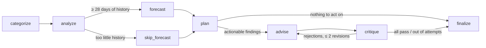

# FinPilot — a proactive, multi-agent financial agent

**Agent Arena 2026 · Track 02.** FinPilot ingests a person's bank transactions, learns how they behave,
forecasts where their money is heading, simulates "what-if" decisions against their real trajectory,
and proactively tells them one specific thing to do. Each recommendation has to cite its evidence and
pass a critic before the user sees it.

All LLM calls go through **[Mesh API](https://api.meshapi.ai)**, which is OpenAI-compatible
(`base_url="https://api.meshapi.ai/v1"`, key in `MESH_API_KEY`). See [`app/llm.py`](app/llm.py).

---

## What it does (end to end)

1. **Ingest:** upload a bank CSV (amount or debit/credit layout) or load a synthetic persona.
2. **Categorize:** rules handle known brands. Mesh-LLM handles the long tail (local kirana stores,
   brands the rules don't list, person-to-person UPI). Keyword heuristics are the offline fallback.
3. **Analyze:** detects recurring payments, subscriptions, overlapping services, price hikes,
   category spikes, one-off outliers, duplicate charges and the savings rate.
4. **Forecast:** a 90-day (or until goal date) Monte Carlo of the balance with calibrated P10/P50/P90 bands. It
   includes yearly bills the user declares (insurance, school fees) that a monthly pattern can't show.
5. **Simulate:** answers "Can I afford a ₹60k trip next month?", "What if I cancel Hotstar?" and "Cut food
   delivery by 30%" against the same random futures as the baseline.
6. **Advise:** specific actions with rupee impact ("Keep NETFLIX, cancel AMAZON PRIME VIDEO and DISNEY HOTSTAR,
   saving ₹598/month"). Each one cites the finding that triggered it.
   - Goal advice adapts to progress: behind → the exact extra ₹/month needed; ahead → reach it early, redirect the surplus.
   - A falling chance since the last run becomes an alert.
7. **Critique and revise:** a critic verifies every recommendation. Failures loop back to the advisor with feedback.
8. **Deliver proactively:** an APScheduler job runs the pipeline weekly and sends a one-insight, one-action
   digest (Telegram if configured, always stored).
9. **Audit:** every agent decision is stored with its reason. `GET /api/recommendations/{id}/why` returns the
   evidence and the decision trail for any recommendation.

## Agents and how they cooperate

The coordinator is a LangGraph state graph. It doesn't just chain the agents: at three points it decides
where the run goes next, and it logs each decision with its reason.



```
 Ask:  question ─▶ classify ──afford / what_if──▶ simulate ─▶ respond (grounded rewrite)
                           └──question──────────▶ answer (grounded QA over user's data)
```

`GET /api/graph` (or `python -m app.graph`) prints both graphs as Mermaid generated from the compiled graphs.
The dashboard's "How the agents ran" panel shows the path each run actually took.

| Agent | Job | Tools / prompt | File |
|---|---|---|---|
| **Coordinator** | Routes work through the graph. Classifies free-form questions into intents and scenarios. Decides whether to revise or finalize. | LangGraph conditional edges, its own classification prompt | [`graph.py`](app/graph.py), [`agents/coordinator.py`](app/agents/coordinator.py) |
| **Categorizer** | Labels each transaction | Regex rules → Mesh LLM, batched by merchant, with merchant memory → keyword fallback | [`agents/categorizer.py`](app/agents/categorizer.py) |
| **Analyzer** | Behaviour over time and anomalies | Recurrence detection, compound-Poisson spike test, robust-z outliers, overlap groups. LLM writes the narrative. | [`agents/analyzer.py`](app/agents/analyzer.py) |
| **Forecaster** | Trajectory, goals and what-ifs | Scheduled recurring flows + weekly block bootstrap. Common random numbers for scenarios. | [`agents/forecaster.py`](app/agents/forecaster.py) |
| **Advisor** | Specific, quantified actions | Computed candidate actions → LLM ranks and personalizes, citing finding ids | [`agents/advisor.py`](app/agents/advisor.py) |
| **Critic** | Verifies advice before delivery | Deterministic checks: evidence, number grounding, specificity, impact bounds, duplicates | [`agents/critic.py`](app/agents/critic.py) |
| Digest writer | Weekly proactive message | Its own prompt, grounded against the run | [`digest.py`](app/digest.py) |

## Key design decisions

- **Numbers come from code, words from the LLM.** Detection, forecasting and impact sizing are deterministic
  statistics over the user's own data. The LLM categorizes the long tail, ranks and phrases advice, and parses
  questions. Every figure an LLM writes is checked against the evidence by [`grounding.py`](app/grounding.py).
  An answer that cites an unsupported number is rejected (advice) or replaced by the computed text (narrative,
  answers, digest).
- **The critic is code, not another prompt.** An LLM judging an LLM can be argued with. Five explicit checks
  can't. Rejections go back to the advisor with the exact issues, for up to 2 revisions. After that the bad
  recommendation is dropped and a computed one backfills it. All of this is logged.
- **Common random numbers for what-ifs.** Baseline and scenario share the same bootstrap draws, so a ₹50,000
  purchase moves the projected balance by exactly ₹50,000. The difference is the decision, not noise
  (verified in eval §4).
- **Spike detection that respects noise.** Monthly category spend is a compound Poisson sum, so the test uses
  `sd = sqrt(rate · E[amount²])` estimated from every historical transaction, rather than the sample SD of 5–6
  monthly totals. Thresholds were tuned on dev seeds 100–114 and are reported on test seeds 0–9.
- **One-offs are reported, not extrapolated.** Outliers (≥20% of monthly income, or robust z ≥ 8) become their
  own finding and are excluded from spike detection, the underlying savings rate and the forecast's
  bootstrap pool.
- **Works without a key.** With no `MESH_API_KEY` (or `FINPILOT_OFFLINE=1`) every agent falls back to its
  deterministic path, so tests and CI are reproducible. With a key, the same graph uses Mesh.
- **Pure graph, separate persistence.** `graph.py` takes a DataFrame and returns results. `service.py`
  persists them. The eval harness runs exactly the production graph.
- **Calibrated uncertainty, tuned only on dev data.** A raw 13-week bootstrap under-states tail weeks, so each
  simulated week is widened around the average week. The factor (1.3) is the smallest that reaches 80% coverage
  on dev seeds ([`eval/TUNING_forecast.md`](eval/TUNING_forecast.md)); test-seed results are reported unchanged.
- **Affordability is judged against your baseline.** If your balance is already at risk, a ₹500 purchase is
  "tight, and here is why", not "unaffordable". The verdict separates existing risk from the risk the decision adds.
- **Fail soft, fast.** Each Mesh call has a 30 s timeout and 1 retry, then falls back. Short statements skip the
  forecast instead of crashing. Unknown merchants go to Mesh in parallel batches and are remembered in SQLite,
  so they are never asked about twice.

## Self-evaluation

`eval/run_eval.py` generates labelled synthetic statements for 3 personas (student, young professional,
family). Each has realistic Indian bank narrations, salary/rent/EMI/SIP, subscriptions and weekday/weekend
rhythm. Known patterns are planted in the last month: food-delivery or shopping spike, Netflix/broadband price
hike, ₹43k–78k one-off purchase, duplicate charge, overlapping streaming services. The pipeline never sees the
labels: the ingester drops `true_category`.

Offline results ([`eval/RESULTS_offline.md`](eval/RESULTS_offline.md), 30 datasets, test seeds 0–9):

| What | Result |
|---|---|
| Categorization accuracy: rules only / + heuristics | 81.9% / 91.4% (long-tail merchants: 0% → 52.5%) |
| Pattern detection, all kinds | precision **0.89**, recall **0.92** (spikes are hardest: P 0.78, R 0.70) |
| Next-month spend MAPE | **15.9%** vs 19.0% (last month), 16.2% (3-month mean) |
| Month-end balance MAPE (regular months) | **6.8%** |
| P10–P90 band coverage (regular months) | **73.3%** (63.3% before calibration; nominal 80%) |
| What-if properties (exact purchase delta, exact subscription saving, exact bill, cuts never hurt, …) | 90/90 |
| Delivered advice: grounded / cites evidence / top-3 issues covered | 100% / 100% / 100% |
| Goal advice matches status / following "save ₹X more a month" reaches the goal | 100% / 100% (76 behind goals) |

With `MESH_API_KEY` set, `python -m eval.run_eval` also measures the LLM categorization tier, LLM-written
advice and the critic's first-pass rate and revision loops. It writes `eval/RESULTS.md`.

**Known gaps (honest):**
- After calibration the P10–P90 band covers 73% of regular months on test seeds, against 81% on the dev seeds
  it was tuned on. It is still somewhat narrow out of sample.
- Spike recall is limited for low-frequency categories: family shopping is ~5 purchases a month.
- Yearly bills are forecast only once the user declares them. A bill seen once in the history isn't detected
  automatically.
- The heuristic tier misfiles long-tail travel sites as transfers, which causes most of the large-transaction
  false alarms. The LLM tier is meant to fix that.

Design history: [PLAN.md](PLAN.md) (the original build) and [PLAN-2.md](PLAN-2.md) (the second pass:
routing, calibration, bills, adaptive goals).

## Run it

```bash
# with uv
uv sync                          # creates .venv and installs everything (incl. pytest)
cp .env.example .env             # add your Mesh key (rsk_...)
uv run python -m app.llm --ping  # checks the key, model ids and one tiny chat call
uv run main.py                   # http://localhost:8000

# or with pip
python -m venv .venv && source .venv/bin/activate      # Windows: .venv\Scripts\activate
pip install -r requirements.txt
uvicorn app.main:app --reload

# or with Docker (scheduler on, data in a volume)
docker build -t finpilot . && docker run -p 8000:8000 --env-file .env -v finpilot:/data finpilot
```

To deploy on Render, use New → Blueprint → this repo (`render.yaml`) and paste `MESH_API_KEY` when asked.

In the dashboard pick a persona, then **Load sample**. You can also upload your own CSV (columns: `date`,
`description`/`narration`, and `amount` or `debit`/`credit`, plus optional `balance`). Then ask things like
*"Can I afford a ₹60,000 trip next month?"* or add a goal and see the advice adapt.

```bash
pytest                                 # 25 offline tests (API, routing, LLM revise/drop paths, critic, simulation)
python -m eval.run_eval --offline      # deterministic eval → eval/RESULTS_offline.md
python -m eval.tune_forecast           # forecast spread tuning on dev seeds → eval/TUNING_forecast.md
python -m eval.run_eval                # with Mesh → eval/RESULTS.md
python -m app.synthetic --out data     # regenerate sample statements + planted labels
```

### API

| Method | Path | Purpose |
|---|---|---|
| POST | `/api/users/{id}/upload` | CSV upload (`file`, optional `opening_balance`) |
| POST | `/api/users/{id}/sample/{persona}` | Load a synthetic persona |
| POST | `/api/users/{id}/analyze` | Run the full agent pipeline |
| POST | `/api/users/{id}/ask` | `{"question": "..."}` → routed answer or simulation |
| POST | `/api/users/{id}/simulate` | Explicit scenario (`purchases`, `monthly_changes`, `category_cuts`, `cancel`) |
| POST/GET | `/api/users/{id}/goals` | Savings goals: status (behind / on track / ahead) and per-run history |
| POST/GET | `/api/users/{id}/bills` | Yearly or periodic bills the forecast should include |
| DELETE | `/api/users/{id}/goals/{goal_id}`, `/api/users/{id}/bills/{bill_id}` | Remove a goal or bill |
| GET | `/api/recommendations/{rec_id}/why` | Evidence + decision trail for one recommendation |
| GET | `/api/runs/{run_id}/audit` | Full decision trail of a run |
| POST | `/api/users/{id}/digest` | Send the proactive digest now (also scheduled weekly) |
| GET | `/api/health?deep=true` | LLM mode, scheduler status, and a Mesh key/model check |
| GET | `/api/graph` | Both LangGraph graphs as Mermaid |

## Repository layout

```
app/
  agents/        categorizer, analyzer, forecaster, advisor, critic, coordinator
  graph.py       LangGraph pipeline + ask graph
  llm.py         Mesh API client (the only LLM entry point)
  grounding.py   number-grounding checks shared by critic / narrative / answers
  service.py     persistence around the graph     db.py  SQLite schema
  digest.py      APScheduler weekly digest          main.py  FastAPI + dashboard
  synthetic.py   labelled statement generator       ingest.py  CSV normalisation
eval/run_eval.py self-evaluation → eval/RESULTS*.md, results*.json
eval/tune_forecast.py  spread calibration on dev seeds → eval/TUNING_forecast.md
tests/           offline pytest suite (fake LLM for the revision paths)
main.py          `python main.py` launcher      Dockerfile, render.yaml  deployment
data/            sample statements + planted-pattern labels
```
